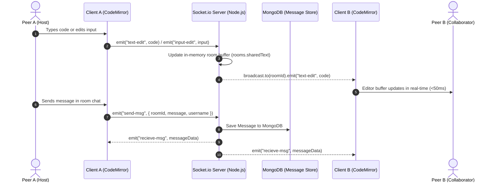
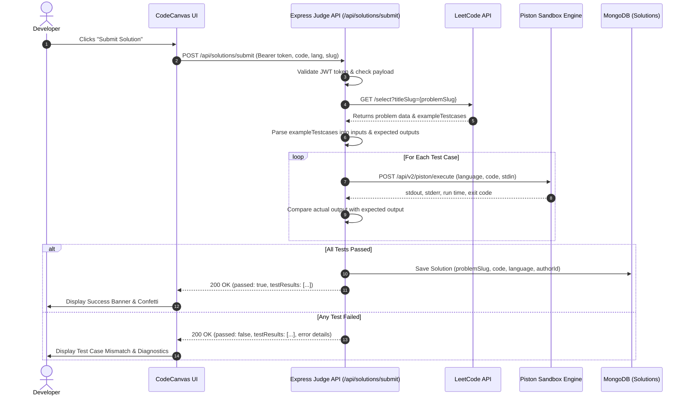

# 🚀 CodeCanvas

<div align="center">

**A Next-Generation Real-Time Collaborative Coding, Problem-Solving & Social Hub for Programmers**

[](https://react.dev/)
[](https://vitejs.dev/)
[](https://nodejs.org/)
[](https://expressjs.com/)
[](https://www.mongodb.com/)
[](https://socket.io/)
[](LICENSE)

[Features](#-key-features) • [Tech Stack](#-tech-stack) • [Architecture](#-system-architecture) • [Getting Started](#-getting-started) • [API Reference](#-api-endpoints) • [Author](#-author)

</div>

---

## 📖 Overview

**CodeCanvas** is an all-in-one developer workspace designed to bridge the gap between practicing algorithms, writing code, and collaborating with peers in real time. 

Built with the modern **MERN** stack (React 19, Node.js, Express, MongoDB) enhanced with **Socket.io** and the **Piston Remote Execution Engine**, CodeCanvas empowers developers to:
- Write and execute code instantly in **C++, Python, Java, and JavaScript**.
- Create or join **real-time pair programming rooms** with synchronized code editing, shared standard input, and integrated live chat.
- Explore and solve **curated LeetCode problems** with dynamic tag filters and automated test case verification.
- Connect with other developers, share solutions, engage in technical discussions, and track upcoming competitive programming contests.

---

## ✨ Key Features

### 💻 1. Interactive In-Browser Code Execution Engine
- **Multi-Language Support**: Seamlessly switch between C++, Python 3, Java, and JavaScript.
- **CodeMirror 6 & Dracula Theme**: Clean, responsive code editor with syntax highlighting, line numbers, and keyboard navigation.
- **Instant Output & Custom Stdin**: Provide custom inputs and view stdout, execution runtime, and compiler diagnostics powered by the Piston API.

### 🌐 2. Real-Time Collaborative Coding Rooms
- **Instant Room Creation**: Spin up custom private rooms with unique room IDs.
- **Bidirectional State Sync**: Real-time code synchronization (`text-edit`) and custom input synchronization (`input-edit`) via WebSockets.
- **Integrated Room Chat**: In-room live chat with persistent conversation history stored in MongoDB.
- **Live Presence Detection**: Real-time participant lists and join/leave announcements.

### 🧩 3. LeetCode Problem Hub & Automated Judge
- **Dynamic Problem Catalog**: Browse hundreds of algorithmic problems with debounced real-time title search.
- **Tag Filtering**: Filter problems by category (e.g., Arrays, Dynamic Programming, Graphs) with dynamic AND/OR logical modes.
- **Automated Test Runner**: Backend-powered test case execution that evaluates submissions against example test suites with detailed pass/fail breakdowns.

### 💬 4. Community Discussions & Solution Showcase
- **Peer Discussions**: Post questions, clarify problem constraints, and discuss approaches.
- **Community Solutions**: Browse accepted solutions with syntax highlighting, voting (upvotes/downvotes), and author attribution.
- **Solution Bookmarking**: Save valuable explanations and reference implementations for revision.

### 🏆 5. Contest Calendar & Competitive Tracker
- **Contest Aggregator**: Stay up-to-date with active and upcoming coding contests from major competitive programming platforms.
- **Interactive Calendar**: Visual date tracking so developers never miss a live contest or hackathon.

### 👤 6. Developer Profiles & Codeforces Integration
- **Custom Profiles**: Showcase skills, programming languages, contact information, and biography.
- **Codeforces Sync**: Connect Codeforces handles to display live competitive programming ratings and badges.
- **Social Discovery**: Search for users by username and explore friend profiles.

---

## 🛠️ Tech Stack

| Layer | Technologies | Highlights |
| :--- | :--- | :--- |
| **Frontend** | React 19, Vite 6, React Router DOM v7 | High-performance SPA with client-side routing & hot-module reloading |
| **Code Editor** | CodeMirror 6, `@uiw/react-codemirror`, Dracula Theme | Extensible code editor with AST-based language parsing |
| **Styling & Icons**| Custom Modular CSS, Lucide React, React Icons | Modern dark-mode UI with fluid animations |
| **Backend** | Node.js, Express 5, HTTP Server | Modular REST API with structured controllers, routes, and middleware |
| **Real-Time** | Socket.io (Client & Server) | Low-latency bi-directional WebSocket event communication |
| **Database** | MongoDB, Mongoose 8 | Robust NoSQL schemas with indexing, references, and data validation |
| **Authentication** | JSON Web Tokens (JWT), Bcrypt.js | Stateless bearer authentication with salted password hashing |
| **Execution Engine** | Piston Execution API | Sandboxed, high-speed remote code execution service |
| **Third-Party APIs**| LeetCode API, Codeforces API | Real-time problem datasets and contest schedules |

---

## 🏗️ System Architecture

CodeCanvas follows a **decoupled, event-driven multi-tier architecture** designed for sub-millisecond real-time collaboration, sandboxed code execution, and high-performance problem solving.

### High-Level Architectural Blueprint

```mermaid
flowchart TD
    subgraph Presentation ["1. Presentation Layer (Frontend - React 19 + Vite)"]
        direction TB
        UI["Web App & Reactive UI (Dashboard, Rooms, Calendar)"]
        Editor["CodeMirror 6 In-Browser IDE (AST Syntax Highlighting)"]
        WS_Client["Socket.io WebSocket Client (Real-Time State Sync)"]
        Auth_State["Client Auth Guard & Local Storage (JWT Handler)"]
        UI --- Editor
        UI --- WS_Client
        UI --- Auth_State
    end

    subgraph Gateway ["2. Gateway & Security Layer (Express 5 HTTP + WS Engine)"]
        direction TB
        CORS["CORS Policy & Security Headers"]
        Parser["Body Parser & JSON Payload Sanitizer"]
        JWT_MW["JWT Authentication & Token Validation Middleware"]
        CORS --> Parser --> JWT_MW
    end

    subgraph Services ["3. Application & Micro-Service Layer"]
        direction TB
        RoomService["Room & Presence Manager (Dual-Buffer Sync: Code & Stdin)"]
        JudgeService["Remote Judge & Execution Pipeline (Piston Integration)"]
        ProblemService["Problem Aggregator & Dynamic Tag Filter Engine"]
        DiscussionService["Community Discussion & Voting Engine"]
        ProfileService["User Profile & Codeforces Stats Synchronizer"]
    end

    subgraph Storage ["4. Data Persistence Layer (MongoDB + Mongoose 8 ODM)"]
        direction TB
        M_User[("Users Collection (Credentials, Skills, Profiles)")]
        M_Solution[("Solutions Collection (Codes, Languages, Votes)")]
        M_Discussion[("Discussions Collection (Threads & Nested Comments)")]
        M_Message[("Chat Messages Collection (Room History)")]
        M_Bookmark[("Bookmarks Collection (Saved Solutions)")]
    end

    subgraph External ["5. External Infrastructure & Cloud Services"]
        direction TB
        PistonAPI["Piston Code Execution Engine (Multi-Language Sandbox)"]
        LeetAPI["LeetCode Contest & Problem Dataset API"]
        CFAPI["Codeforces User Statistics API"]
    end

    Presentation -->|HTTP REST Requests (Bearer Token)| Gateway
    WS_Client <-->|Bi-directional WebSockets (ws://)| RoomService

    JWT_MW --> ProblemService
    JWT_MW --> DiscussionService
    JWT_MW --> JudgeService
    JWT_MW --> ProfileService

    RoomService -->|Persist Chat| M_Message
    DiscussionService <--> M_Discussion
    ProfileService <--> M_User
    ProfileService <-->|Fetch Ratings| CFAPI
    ProblemService <-->|Fetch Metadata| LeetAPI
    
    JudgeService -->|1. Fetch Test Cases| LeetAPI
    JudgeService -->|2. Execute Code in Sandbox| PistonAPI
    JudgeService -->|3. Save Accepted Solutions| M_Solution
    M_User -.->|References| M_Solution
    M_User -.->|References| M_Discussion
```

### Detailed Workflow Sequences

#### 1. Real-Time Collaborative Room Synchronization


#### 2. Code Execution & Automated Verification Pipeline


### Key Architectural Design Patterns

| Pattern | Implementation | Architectural Value |
| :--- | :--- | :--- |
| **In-Memory Dual-Buffer Sync** | Map-based Room State in Socket.io (`rooms.sharedText` & `rooms.sharedInput`) | Zero database bottlenecks during keystrokes; sub-50ms bi-directional sync across all room peers. |
| **Sandboxed Code Isolation** | Piston Execution REST API Engine | Prevents local server crashes or remote code execution (RCE) vulnerabilities by isolating un-trusted student/user code inside isolated worker runtimes. |
| **Stateless Bearer Authentication** | Cryptographic JWT with SHA-256 signatures & Bcrypt password salts | Enables horizontal backend scaling without sticky sessions or centralized Redis session stores. |
| **Debounced Search Ingestion** | Custom `useDebounce` hook with 300ms window on problem querying | Drastically cuts unnecessary backend requests and eliminates UI stutter when filtering through 200+ LeetCode problems. |
| **Document Referencing & Population** | Mongoose `ref` linking Users, Solutions, and Discussions | Maintains data normalization while allowing single-round-trip populated relational queries (`.populate('author', 'Username')`). |

---

## 📂 Project Directory Structure

```text
CodeCanvas/
├── backend/
│   ├── config/
│   │   └── db.js                 # MongoDB connection handler
│   ├── middleware/
│   │   └── auth.js               # JWT bearer verification middleware
│   ├── models/
│   │   ├── bookmarksModel.js     # User solution bookmark schema
│   │   ├── DiscussionModel.js    # Problem discussion & comments schema
│   │   ├── messageModel.js       # Persistent collaborative chat schema
│   │   ├── Solution.js           # Submitted solutions & voting schema
│   │   └── UserModel.js          # User profile & credentials schema
│   ├── routes/
│   │   ├── Contests.js           # Live contest aggregator endpoints
│   │   ├── Discussions.js        # Problem discussion CRUD routes
│   │   ├── LoginRoute.js         # User registration & JWT authentication
│   │   ├── Profile.js            # User profile management & Codeforces sync
│   │   └── Solutions.js          # Automated code execution & submissions
│   ├── socketHandler.js          # Socket.io room lifecycle & state sync
│   ├── index.js                  # Express & Socket.io server bootstrap
│   ├── .env.example              # Backend environment template
│   └── package.json              # Backend dependencies & scripts
│
├── frontend/
│   ├── public/                   # Static assets & favicon
│   ├── src/
│   │   ├── assets/               # Logos and branding assets
│   │   ├── components/           # Reusable UI components
│   │   │   ├── CodeEditor.jsx    # CodeMirror 6 runner & editor component
│   │   │   ├── Header.jsx        # Primary application navigation bar
│   │   │   ├── LanguageSelector  # Multi-language selector dropdown
│   │   │   ├── Problemcard.jsx   # Problem overview card with badges
│   │   │   ├── RequireAuth.jsx   # Protected route wrapper component
│   │   │   └── Toast.jsx         # Notification toast alert system
│   │   ├── pages/                # Top-level view routes
│   │   │   ├── Calendar.jsx      # Contest tracking & schedule calendar
│   │   │   ├── CodeEditorPage.jsx# Standalone full-page code playground
│   │   │   ├── Dashboard.jsx     # Problem browser with tag & search filters
│   │   │   ├── Discussion.jsx    # Community discussion boards
│   │   │   ├── Home.jsx          # Landing hero page with feature cards
│   │   │   ├── Login.jsx         # User login portal
│   │   │   ├── ProblemDetail.jsx # Problem view, editor & test case runner
│   │   │   ├── Register.jsx      # User account registration
│   │   │   ├── RoomPage.jsx      # Real-time collaborative coding room
│   │   │   ├── RoomSelection.jsx # Room join & creation lobby
│   │   │   ├── SolutionsList.jsx # Community solutions catalog
│   │   │   └── UserProfile.jsx   # Profile management & achievements
│   │   ├── styles/               # Modular component styling
│   │   ├── App.jsx               # Application routes & layout
│   │   └── main.jsx              # React DOM root entry point
│   ├── .env.example              # Frontend environment template
│   ├── vite.config.js            # Vite configuration
│   └── package.json              # Frontend dependencies & scripts
│
├── .gitignore                    # Git tracking ignore rules
├── LICENSE                       # MIT License
└── README.md                     # Project documentation
```

---

## ⚡ Getting Started

Follow these step-by-step instructions to set up and run CodeCanvas on your local machine.

### 1. Prerequisites
- **Node.js**: `v18.0.0` or higher ([Download](https://nodejs.org/))
- **MongoDB**: Local MongoDB instance or [MongoDB Atlas](https://www.mongodb.com/atlas) URI
- **Git**: Installed on your system

### 2. Clone the Repository
```bash
git clone https://github.com/2804Chaitanya/Code_Canvas.git
cd Code_Canvas
```

### 3. Backend Setup

1. Navigate to the backend directory:
   ```bash
   cd backend
   ```
2. Install dependencies:
   ```bash
   npm install
   ```
3. Configure environment variables:
   ```bash
   cp .env.example .env
   ```
   Edit `.env` with your settings:
   ```env
   PORT=3000
   MONGODB_URI=mongodb://localhost:27017/codecanvas
   JWT_SECRET=your_super_secret_jwt_key
   JUDGE_URL=https://emkc.org/api/v2/piston/execute
   ```
4. Start the backend development server:
   ```bash
   npm run dev
   # Server runs at http://localhost:3000
   ```

### 4. Frontend Setup

1. Open a new terminal and navigate to the frontend directory:
   ```bash
   cd ../frontend
   ```
2. Install dependencies:
   ```bash
   npm install
   ```
3. Configure environment variables:
   ```bash
   cp .env.example .env
   ```
   Verify `.env` contents:
   ```env
   VITE_BACKEND_URL=http://localhost:3000
   VITE_JUDGE=https://emkc.org/api/v2/piston/execute
   VITE_API_URL=https://alfa-leetcode-api.onrender.com
   ```
4. Launch the Vite development server:
   ```bash
   npm run dev
   # App will be accessible at http://localhost:5173
   ```

---

## 🔌 API Endpoints

### 🔐 Authentication (`/`)
| Method | Endpoint | Description | Auth Required |
| :--- | :--- | :--- | :---: |
| `POST` | `/register` | Register a new user account & return JWT | No |
| `POST` | `/login` | Authenticate user credentials & return JWT | No |

### 👤 User & Profile (`/user` & `/users`)
| Method | Endpoint | Description | Auth Required |
| :--- | :--- | :--- | :---: |
| `GET` | `/user/profile` | Retrieve the authenticated user's profile | Yes |
| `POST` | `/user/profile/update` | Update profile information, skills & Codeforces handle | Yes |
| `GET` | `/users/:username` | Query users by username prefix | No |
| `GET` | `/user/:id` | View public profile of a user by ID | Yes |

### 💻 Code Execution & Solutions (`/api/solutions`)
| Method | Endpoint | Description | Auth Required |
| :--- | :--- | :--- | :---: |
| `POST` | `/api/solutions/submit` | Execute code against problem test cases & save solution | Yes |
| `GET` | `/api/solutions/:problemSlug` | Retrieve community solutions for a problem | No |
| `GET` | `/api/solutions/detail/:id` | Fetch full solution details and implementation | No |
| `POST` | `/api/solutions/vote` | Upvote or downvote a shared solution | No |
| `DELETE`| `/api/solutions/:id` | Delete an author's submitted solution | Yes |

### 💬 Discussions (`/discussions`)
| Method | Endpoint | Description | Auth Required |
| :--- | :--- | :--- | :---: |
| `GET` | `/discussions/:problemSlug` | Retrieve discussion threads for a specific problem | No |
| `POST` | `/discussions/` | Create a new discussion thread | Yes |
| `POST` | `/discussions/:id/comment` | Add a comment to an existing discussion thread | Yes |

### 🏆 Contests (`/api/contests`)
| Method | Endpoint | Description | Auth Required |
| :--- | :--- | :--- | :---: |
| `GET` | `/api/contests` | Fetch current and upcoming contest schedule | No |

### 🌐 WebSocket Events (Socket.io)
| Event Name | Direction | Payload | Description |
| :--- | :---: | :--- | :--- |
| `join-room` | Client ➔ Server | `{ username, roomId }` | Connects user to a collaborative room |
| `room-init` | Server ➔ Client | `{ users, sharedText, sharedInput, previousMessages }` | Hydrates newly joined client with state |
| `text-edit` | Bi-directional | `text` (String) | Syncs CodeMirror editor buffer across peers |
| `input-edit` | Bi-directional | `input` (String) | Syncs custom stdin input across peers |
| `send-msg` | Client ➔ Server | `{ roomId, message, username }` | Broadcasts and persists a new room chat message |
| `recieve-msg` | Server ➔ Client | `{ username, message, timestamp }` | Delivers real-time chat messages to room |
| `user-joined` | Server ➔ Client | `username` | Notifies peers when a user enters the room |
| `user-left` | Server ➔ Client | `username` | Notifies peers when a user exits the room |

---

## 🔒 Security Best Practices

- **Password Hashing**: User passwords are encrypted with `bcrypt` using 10 salt rounds prior to persistence.
- **Stateless Authorization**: Protected endpoints require standard `Bearer <JWT_TOKEN>` authorization headers.
- **Input Validation**: Sanitization and payload length validation on sensitive registration and submission routes.
- **CORS Whitelisting**: Strict origin policy guarding the backend from unauthorized cross-origin requests.

---

## 🤝 Contributing

Contributions, issues, and feature requests are welcome!

1. Fork the Project
2. Create your Feature Branch (`git checkout -b feature/AmazingFeature`)
3. Commit your Changes (`git commit -m 'feat: Add some AmazingFeature'`)
4. Push to the Branch (`git push origin feature/AmazingFeature`)
5. Open a Pull Request

---

## 📄 License

Distributed under the **MIT License**. See [`LICENSE`](LICENSE) for more information.

---

## 👨‍💻 Author

**Chaitanya**
- Email: [chaitanyamalla40@gmail.com](mailto:chaitanyamalla40@gmail.com)
- GitHub: [@2804Chaitanya](https://github.com/2804Chaitanya)
- Repository: [Code_Canvas](https://github.com/2804Chaitanya/Code_Canvas.git)

---

<div align="center">
⭐ If you found this project interesting or helpful, please consider giving it a star on GitHub! ⭐
</div>
